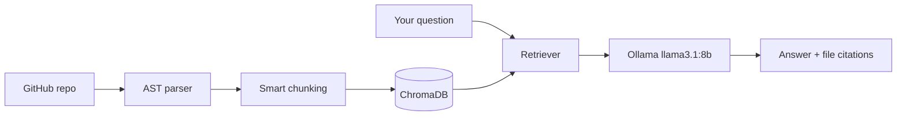

<div align="center">


<a href="https://github.com/nitish-creat">
  
</a>

<br/>

<p>
  
  
  
</p>

<a href="https://linkedin.com/in/nitish-rajput"></a>
<a href="mailto:nitishrana2242006@gmail.com"></a>
<a href="https://github.com/nitish-creat"></a>

</div>

---

## 👨‍💻 About Me

```typescript
const nitish = {
  name:      "Nitish Rana",
  role:      "AI/ML Engineer | Full-Stack Developer",
  location:  "Punjab, India 🇮🇳",
  education: "B.Tech CSE (final year) @ Lovely Professional University",
  focus:     ["GenAI", "RAG Systems", "LLM Engineering", "Full-Stack"],
  building:  "RepoGPT: RAG-based GitHub repo intelligence",
  exploring: ["Agentic AI", "ReAct", "LangGraph", "Agentic RAG"],
  askMeAbout:["RAG", "Vector DBs", "FastAPI", "Next.js", "DSA in C++"],
  openTo:    ["Internships", "Open Source", "Hackathons", "Collabs"],
  motto:     "Ship it, break it, diagnose it, document the root cause.",
};
```

---

## 🔥 Featured Projects

<table>
<tr>
<td width="50%" valign="top">

### 🧠 [RepoGPT](https://github.com/nitish-creat/RepoGPT)
**Chat with any codebase.** AST-aware chunking, ChromaDB retrieval, local Ollama (llama3.1:8b) inference, and citation-based answers to curb hallucination. Next.js 16 frontend with a 3D particle visualization.

`FastAPI` `ChromaDB` `Ollama` `Next.js` `RAG`

</td>
<td width="50%" valign="top">

### 🎯 [LeetPush](https://github.com/nitish-creat/LeetPush)
**LeetCode → GitHub, automatically.** Manifest V3 extension with a custom content-script bundler. Syncs solved problems and can import from GitHub to restore local tracking state.

`JavaScript` `Chrome APIs` `GitHub API`

</td>
</tr>
<tr>
<td width="50%" valign="top">

### 🌿 [NoteGit](https://github.com/nitish-creat/NoteGit)
**Git-style version control for DSA notes.** C++ core with a custom HashMap, Stack, UndoRedoManager, CommitLinkedList and a branch DAG, visualized in React.

`C++` `DSA` `React`

</td>
<td width="50%" valign="top">

### 🚀 [ARISE](https://github.com/nitish-creat/ARISE)
**Gamified self-improvement.** Spatial, Vision-Pro-inspired UI with a canvas star field driven by spring physics.

`React` `Canvas` `UI/UX`

</td>
</tr>
<tr>
<td colspan="2" valign="top">

### 📜 [PolicyLens](https://github.com/nitish-creat/PolicyLens)
**Ask questions about Indian government policy.** Flask + ChromaDB + Ollama RAG pipeline.

`Flask` `ChromaDB` `Ollama` `RAG`

</td>
</tr>
</table>

### 🧬 How RepoGPT answers a question



---

## 🛠️ Tech Stack

<div align="center">

**Languages & Web**<br/>


**Data, Infra & Tools**<br/>


**AI / ML / GenAI**<br/>


</div>

---

## 🧭 Now / Next / Shipped

- [x] RepoGPT v1: AST chunking, ChromaDB, local LLM, citations
- [x] LeetPush: MV3 sync + import-from-GitHub
- [ ] **Now:** agentic RAG on RepoGPT (ReAct loop + tool use)
- [ ] **Next:** LangGraph multi-step reasoning over repos
- [ ] **Next:** retrieval evals (hit-rate / MRR) to measure chunking changes

---

## 🐛 Debug Journal

<details>
<summary><b>Example: React hydration mismatch in Next.js</b> (click to expand; replace with your own real postmortems)</summary>

| | |
|---|---|
| **Symptom** | Console warning: text content did not match server-rendered HTML |
| **Root cause** | Client-only values (`Date.now()`, `window`, random IDs) rendered during SSR |
| **Fix** | Moved them into `useEffect` / `useSyncExternalStore`, or `suppressHydrationWarning` where truly intended |
| **Lesson** | Anything non-deterministic belongs after mount |

</details>

---

## 📊 GitHub Analytics

<div align="center">


</div>

---

## 🐍 Contribution Snake

<div align="center">
<picture>
  <source media="(prefers-color-scheme: dark)" srcset="https://raw.githubusercontent.com/nitish-creat/nitish-creat/output/github-snake-dark.svg" />
  <source media="(prefers-color-scheme: light)" srcset="https://raw.githubusercontent.com/nitish-creat/nitish-creat/output/github-snake.svg" />
  
</picture>
</div>

<div align="center">

### 💜 Thanks for scrolling all the way down!


</div>
